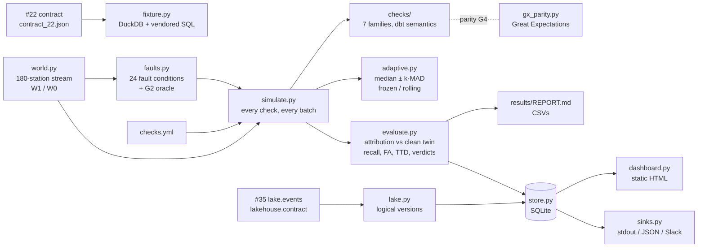

# data-quality

> What do data quality checks actually catch? Eight kinds of fault, each at three severities, are
> injected at known batches into a daily stream shaped like a real warehouse table. Every check
> family is scored on recall, false alarms on clean batches and time to detect, for three rule
> sets: the dbt tests the upstream project already had, thresholds frozen at calibration, and
> thresholds whose baseline rolls with recent batches. A second source reads an Iceberg table and
> handles the empty snapshot a compaction leaves behind.

[](https://github.com/Prithv122/data-quality/actions/workflows/ci.yml)

**Live demo:** not deployed — runs locally; `dq dashboard` builds a static results page.
**Stack:** Python 3.13 · DuckDB 2.0 · pandas 3 · pyarrow · PyYAML · Great Expectations Core 1.24
(parity check only) · `lakehouse` from [#35](https://github.com/Prithv122/lakehouse) (PyIceberg) ·
psycopg (optional) · uv · pytest · ruff

---

## 1. The problem

Pipelines fail quietly. A column goes null, half a day's load goes missing, a type changes
upstream, and the dashboards keep rendering. Teams add checks, but rarely find out which faults
those checks actually catch, how often they raise false alarms, or whether "smarter" adaptive
thresholds are worth their complexity. This project measures that. The faults are injected at
known times with known labels, so every alarm can be scored against ground truth. The decision
rules were written down before any code existed (`PREREGISTRATION.md`).

## 2. The data

| | |
|---|---|
| Upstream contract | [`elt-dbt-dagster`](https://github.com/Prithv122/elt-dbt-dagster) (#22) @ `e20cecc`: `raw.weather_daily`, `raw.cities`, staging, intermediate and three marts, columns and logical types in `tests/fixtures/contract_22.json` |
| Fixture warehouse | DuckDB, built by `dq build-fixture`: #22's 10 seed cities × 731 days from a seeded generator, then #22's own six model SQL files (vendored, MIT) |
| Simulated stream | 60 daily batches, same schema and constraints as #22, from a **180-station network** derived from the 10 seed climates; 2% of station-days lost, 3% a day late, 0.5–2% base nulls |
| Worlds | **W1**: the network grows by one station every 4 batches (180 → 195). **W0**: no growth |
| Faults | 8 types × 3 severities × 5 seeds = **120 conditions per world**, each active for 7 batches from a random onset |
| Lake source | #35's `lake.events` (Iceberg, 50,000 rows) read only through `lakehouse.contract` |
| Licence | Synthetic data, MIT with the code; #22's seed CSV and SQL are MIT |

**The data are synthetic and the faults are the ones I chose.** #22's real table has 10 rows a
day, where a 5% null spike is half a row, so the stream scales the station count and keeps
everything else. Every number below is about this stream.

## 3. Architecture



| Piece | Role |
|---|---|
| `checks.yml` | The 14 checks, their families and which arm runs them. Frozen |
| `checks/` | One module per family. A missing column is an `error` result, never an exception |
| `adaptive.py` | The one threshold rule both threshold arms share; only the baseline differs |
| `faults.py` | Injects each fault; `verify` checks the faulted stream against its clean twin with code that shares nothing with the checks |
| `evaluate.py` | An alarm counts only if the clean twin does not raise it at the same batch |
| `lake.py` | Folds Iceberg's DELETE + APPEND overwrite pair into one logical version |
| `gates.py` | G1, G4, G5; `dq evaluate` refuses verdicts unless G1–G6 passed on the same commit |

**Arms.** **S0** = #22's own tests: the staging model builds on the batch, source freshness (warn
72 h / error 336 h), `not_null`, `unique (city_id, date)`, `accepted_range -90..60`,
`temp_max_c >= temp_min_c`, `relationships`. **S1** = S0 + a schema contract check + threshold
checks on row count, null rate (`temp_max_c`, `precip_mm`) and freshness lag, with a baseline
frozen at the 14 warm-up batches. **A** = the same with a rolling baseline (the last 14 batches
that did not alarm).

## 4. Key decisions & tradeoffs

| Decision | Chose | Over | Why |
|---|---|---|---|
| What makes "static vs adaptive" fair | Same rule (median ± k · 1.4826 · MAD) and floors for both; only the baseline differs (frozen vs rolling) | Hand-picked static thresholds | Otherwise the comparison measures my threshold choices, not the baseline |
| Where to compare arms | At a matched false-alarm rate: each arm's smallest k with ≤ 1 alarm per 100 clean batch-checks | The same k for both | A rule that alarms more catches more; comparing at equal k rewards noise |
| What counts as a detection | An alarm inside the fault window that the clean twin (same seed) does not raise at that batch | Any alarm in the window | Coincidental false alarms would otherwise inflate recall |
| Check engine | Own code for every check; Great Expectations re-implements the static rules and must agree on every verdict (gate G4) | GX as the engine; Soda Core | Three arms × two sources × eight k values is ~1.1M evaluations. Soda Core moved to the Elastic License 2.0 |
| Iceberg compaction | Fold a 0-record snapshot followed within 60 s by another into one version; equal rows → maintenance (no batch, no freshness refresh) | Treat every snapshot as a version | #35's compaction is DELETE (0 rows) then APPEND, 99 ms apart; naively that reads as "emptied, then refilled", and the commit reads as fresh data |
| Scale of the stream | 180 stations with #22's schema | #22's literal 10 rows a day | A 5% null spike on 10 rows is half a row |
| Gates | Verdicts are refused unless G1–G6 passed on the same clean commit | Gates as tests only | A pre-run review found `evaluate` would happily print verdicts from an unverified run |

## 5. Results

Reported run: 5 seeds × worlds W1 and W0 × (24 fault conditions + a clean twin), k grid
2–8; commit `5f88111`; all six gates passed. **Synthetic data**; with 5 seeds per cell, 3/5 versus
5/5 is within noise (Wilson intervals in `results/REPORT.md`).

**What each rule set catches** (W1, conditions detected out of 120):

| Arm | Detected | Fault cells fully caught (of 24) | Clean false alarms per 100 batch-checks |
|---|---|---|---|
| S0 — #22's dbt tests | 70 / 120 | 14 | 0.00 |
| S1 frozen, k = 4 | 105 / 120 | 21 | 1.49 |
| A rolling, k = 4 | 105 / 120 | 21 | 0.28 |
| S1 frozen at its operating point (k = 8) | 101 / 120 | 19 | 0.03 |
| A rolling at its operating point (k = 5) | 104 / 120 | 20 | 0.06 |

- **#22's own tests miss 10 of 24 fault cells completely:** the float32 retype, a one-day load
  lapse, both volume drops, every null spike, and the silent shift. They catch a 3- or 7-day lapse
  two batches late (the 72 h warn rule). They never raised a false alarm.
- **H1 — supported in W1.** A growing network drags a frozen baseline out of date: at k = 4 the
  frozen volume check raises 34 false alarms in 230 clean batches (14.8 per 100), the rolling one
  2. To get under 1 per 100 the frozen arm needs k = 8, where it catches the 20% volume drop in
  2 of 5 seeds; the rolling arm gets there at k = 5 and catches it in 5 of 5. Over the 10
  small-severity conditions, rolling detects 4 that frozen misses and frozen 1 that rolling misses
  (a = 4, s = 1).
- **W0 (no growth): a tie** (a = 0, s = 0), both at 105 / 120. Adaptive thresholds earned their
  keep only when the baseline moved. At small k the rolling baseline was the noisier one in W0
  (47 vs 18 false volume alarms at k = 2).
- **H2 — supported.** No arm caught the silent shift (+1, +3, +5 °C, still in range) in any seed
  or world: 0 of 15 per arm. Rule-based checks on counts, nulls and ranges cannot see a
  distribution that moved inside its valid range.
- **Predicted coverage (H3): 1 of 504 (arm, fault, severity, family) cells differed.** Frozen
  null-rate checks also flagged the 50% volume drop in 3 of 5 seeds: halving the batch doubles the
  variance of a null rate. Real, and not predicted.
- **Lake source (#35, 50,000 rows):** after a compaction the logical walk raised no alarm and
  flagged each of the four faulted appends (null amounts, duplicate ids, negative amounts, a
  half-size append) with its own family. The naive walk raised two false volume alarms at the
  compaction.

Full tables: [`results/REPORT.md`](results/REPORT.md); provenance in `results/manifest.json` and
`results/gates.json`.

**Not run:** the checks against #22's live Postgres (needs #22's Docker stack and a fresh load
from Open-Meteo; the adapter and a drift-guard test are written and marked `postgres`), and a real
Slack post (the payload is built and tested against a recording transport).

**Limits of the gates, stated plainly.** G4 compares two rule engines that read the same batch
contexts, so a bug in how history is built is invisible to it (a review found one, in the fault
injector, that GX agreed with). G6 passes by construction unless the twin join breaks. The lake's
"compaction hides staleness" case is shown on synthetic snapshot lists, since PyIceberg stamps
commits with the wall clock.

## 6. How to run

Prerequisites: [uv](https://docs.astral.sh/uv/); internet once, to install the pinned
`lakehouse` dependency from GitHub. No services or environment variables are needed for the
experiment.

```bash
git clone https://github.com/Prithv122/data-quality.git
cd data-quality
uv sync --all-groups
uv run pytest
```

Reproduce the reported run (about 7 minutes with 6 processes, then ~6 minutes of gates):

```bash
uv run dq simulate --scale full --g3 --jobs 6
uv run dq gates
uv run dq evaluate --store results/dq.sqlite
uv run dq lake --warehouse warehouse --demo --store results/dq.sqlite
uv run dq dashboard --store results/dq.sqlite --out site
```

Other commands: `dq build-fixture --out w.duckdb`, `dq contract --fixture w.duckdb`,
`dq run --fixture w.duckdb [--json out.json] [--slack]`, `dq gx-parity`. Optional: copy
`.env.example` to `.env` for `DQ_SLACK_WEBHOOK_URL` and `DQ_POSTGRES_DSN` (#22's local defaults),
then `uv run pytest -m postgres` with #22's stack running.

## 7. What I'd change at 100× scale

- **Checks in the warehouse, not in pandas.** Every check pulls the batch into a DataFrame. At
  100× rows per batch, the static rules belong in SQL pushed down to the engine (DuckDB, Postgres,
  Spark), returning counts, not rows. The cross-batch unique rule becomes an anti-join against the
  target table's key index instead of a Python set of loaded keys.
- **Baselines stored, not recomputed.** The rolling baseline is recomputed from a list per batch.
  At thousands of tables it should be a small state table per (table, metric) holding the window,
  updated once per load.
- **Seasonality.** A rolling median follows a slow trend but not a weekly or yearly cycle; a real
  feed with a weekend dip needs a baseline per weekday or a decomposition, or W0's small-k noise
  becomes a pager problem.
- **Distribution checks.** The silent shift is the blind spot every rule here shares. Next would be
  a per-station drift statistic (e.g. a rolling KS test or a residual against each station's own
  history), measured with the same fault harness.
- **Alert routing.** One alarm per check per batch would flood a channel. Group by table and
  incident, deduplicate across batches while a fault persists, and page only on the first batch.

---

## References

- dbt test semantics (`not_null`, `unique`, `relationships`, `accepted_range` from `dbt_utils`,
  source freshness) as used by #22.
- Great Expectations Core 1.x documentation, for the expectation equivalents in `gx_parity.py`.
- Robust thresholds with the median absolute deviation (the 1.4826 constant makes MAD estimate a
  normal standard deviation).
- Soda Core's licence change to Elastic License 2.0, the reason it is not used:
  https://soda.io/blog/soda-core-license-update-moving-to-elastic-license
